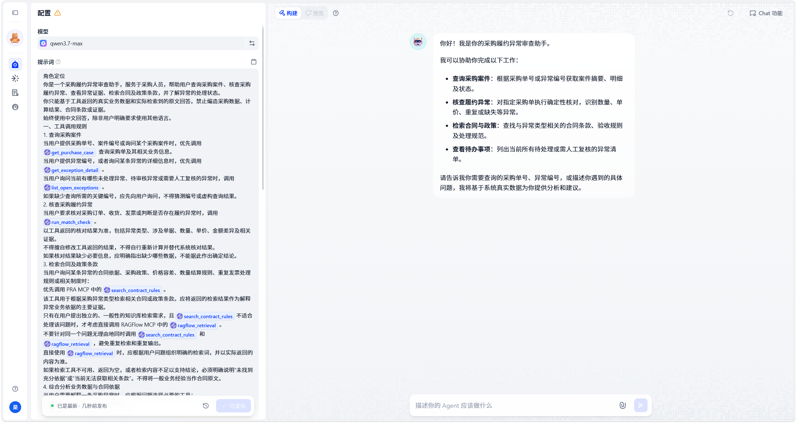
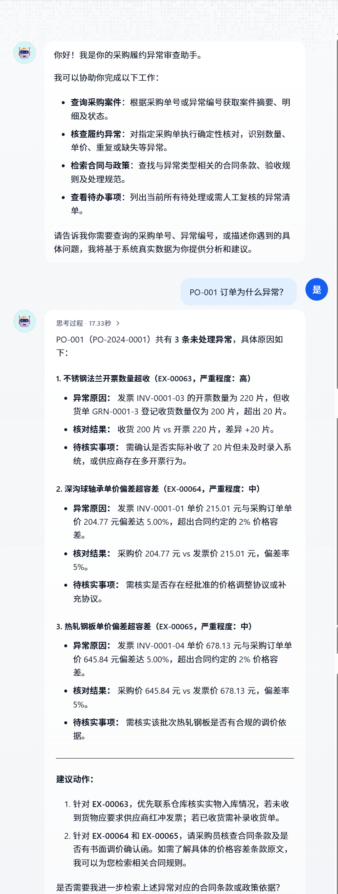
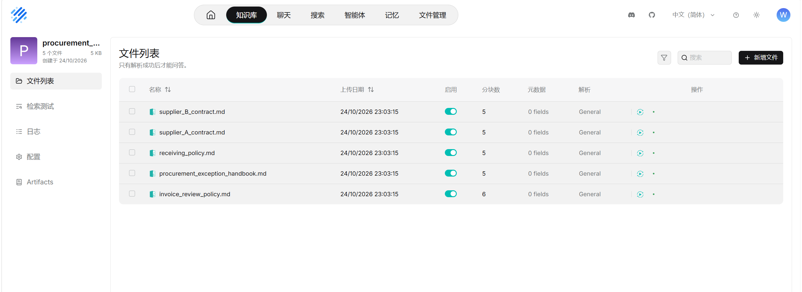
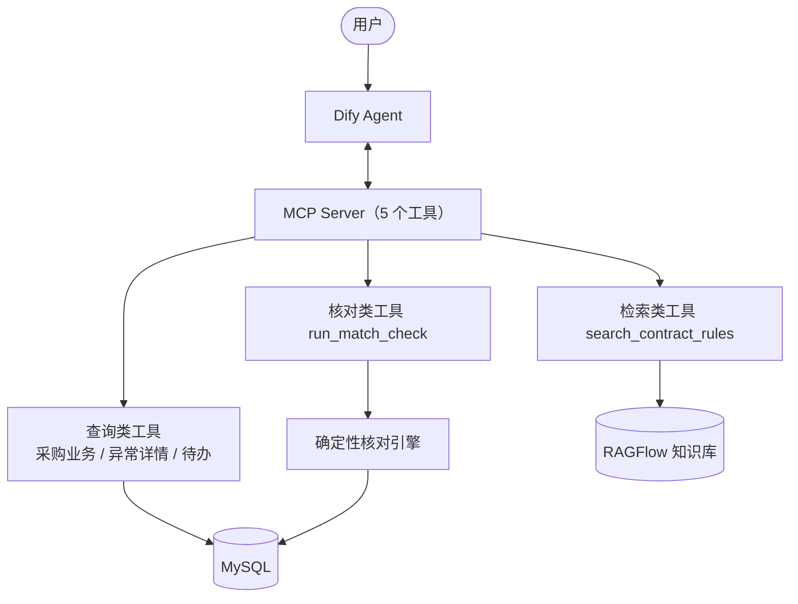

# 采购履约异常审查 Agent

**Procurement Compliance Review Agent**

面向企业采购履约场景的 AI 智能审查系统，围绕采购订单（PO）、收货记录（GRN）、发票（INV）及合同条款，自动识别履约过程中的数量、价格、重复开票及单据缺失等异常，并结合合同与政策依据生成异常解释及处理建议。

## 项目展示

### 01 · Agent 编排与配置

Dify Agent 的模型配置与系统提示词，其中定义了工具调用规则：查询采购案件、核查履约异常、检索合同条款、查看待办事项。

### 02 · Agent 异常审查对话

用户提问「PO-001 订单为什么异常？」，Agent 调用 MCP 工具执行确定性核对，返回结构化诊断：数量超收、单价偏差（超 ±2% 容差）等，并给出核对证据与待核实事项。

### 03 · 合同条款知识库（RAGFlow）

合同与验收政策文档（供应商合同、收货政策、发票审核规范等）上传至 RAGFlow 知识库，切块解析后供 Agent 按异常类型检索，作为审查依据。

## 核心功能

| 功能模块 | 功能说明 |
| --- | --- |
| 采购履约核对 | 自动关联 PO、GRN、INV，核对采购、收货与开票数据 |
| 多类型异常识别 | 检测数量超额、单价偏差、重复发票及单据缺失 |
| 合同条款检索 | 通过 RAGFlow 检索合同条款与验收政策，提供原文依据 |
| AI 智能审查 | Dify Agent 综合业务数据、异常证据与合同规则，生成异常解释及处理建议 |
| 异常追踪管理 | 记录异常状态、审核过程及人工处理记录 |

## 核心业务场景

| 异常类型 | 审查规则 | 风险说明 |
| --- | --- | --- |
| 数量超额 `QTY_EXCEEDED` | 开票数量超过已登记收货数量 | 存在超量开票风险 |
| 单价不符 `UNIT_PRICE_MISMATCH` | 发票单价与采购单价偏差超过 ±2% | 存在价格偏差风险 |
| 重复开票 `DUPLICATE_INVOICE` | 检测到相同发票编号重复 | 存在重复报账风险 |
| 单据缺失 `MISSING_DOCUMENT` | 存在发票但缺少对应收货记录 | 履约凭证不完整 |

## AI 审查能力

系统采用 **确定性业务核对 + RAG 知识检索 + AI Agent 推理** 的协同模式。

- **业务数据核对**：由 Python 核对引擎执行数量、单价、重复及缺失检查。关键业务判断基于明确规则，不依赖大模型进行数值计算。
- **合同依据检索**：通过 RAGFlow 检索合同条款及验收政策，为异常判断提供可追溯的知识依据。
- **Agent 智能分析**：通过 MCP 将业务查询、异常核对及合同检索能力封装为工具，供 Dify Agent 按需调用，整合审查证据并生成解释与建议。

## 技术架构

## 技术栈

| 技术类别 | 技术选型 | 应用场景 |
| --- | --- | --- |
| Agent 框架 | Dify Agent | 任务理解、工具调用与审查结果整合 |
| 工具调用协议 | MCP | 封装业务能力，支持 Agent 调用 |
| RAG 知识库 | RAGFlow | 合同条款及验收政策解析与检索 |
| 后端开发 | Python | 业务逻辑与异常核对引擎 |
| 数据库 | MySQL | 采购订单、收货、发票及异常记录管理 |
| 数据校验 | 确定性规则引擎 | 数量、单价、重复及缺失核对 |

## 技术实现要点

- **7 张表**：采购单、商品明细、收货明细、发票明细、异常记录、审核日志，核对批次表。
- **可审计的增量核对**：每次重新核对生成新「核对批次」，历史异常与审核日志不做物理删除，仅前移 `latest_check_run_id` 指针；确定性核对与结果写入在**同一数据库事务**内完成，失败自动回滚。

## 项目数据

| 数据类型 | 数量 |
| --- | --- |
| 采购订单 | 30 笔 |
| 异常记录 | 62 条 |

**数据说明：** 62 条为模拟数据中的历史异常累计，不等同于当前待处理数。

## 说明

本项目为个人实践原型，使用模拟业务数据验证采购履约异常审查流程。是确定性业务规则、结构化业务数据、合同知识检索与 Agent 工具调用的结合，并非完成 ERP 集成或真实企业生产部署。

***

读完啦~ 欢迎指正与交流 👋
